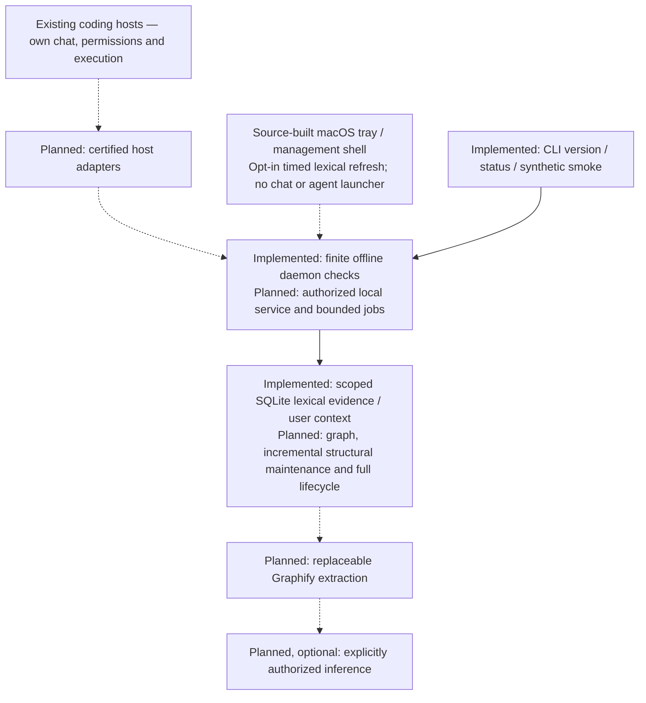

# Threadmark

[](https://github.com/suhaasbadada/threadmark/actions/workflows/ci.yml)
[](LICENSE)

## Project intelligence for every coding agent.

Threadmark is a planned local-first background companion that turns rough developer intent into grounded, project-aware execution briefs. It keeps project understanding portable across coding agents without replacing their tools, permissions, or workflows. It is not another chat application, editor, task dashboard, or agent launcher.

> Explain less. Carry context forward. Give every agent a better starting point.

**Status: bounded Rust lexical core and source-built native macOS shell.** The CLI registers explicitly approved source files, persists lexical source evidence and human context in private SQLite, and returns bounded source-checked queries across restarts. The [native shell](apps/companion/README.md) offers optional session-only, exact-scope timed lexical refresh (off by default), not a watcher or incremental symbol index. There is no distributed/signed companion, listener, inference provider or certified coding-host integration yet. Later workflows remain planned; [core evidence and limitations](docs/progress/phase-2-core.md) distinguish these slices from full phase acceptance.

## Try the foundation from source

With Git, [Rustup](https://rustup.rs/) and Python 3.11+ installed:

```sh
git clone https://github.com/suhaasbadada/threadmark.git
cd threadmark
cargo build --workspace --locked
cargo run --locked -p threadmark-cli -- --version
cargo run --locked -p threadmark-cli -- status
cargo run --locked -p threadmark-cli -- smoke
python3 scripts/check.py
```

Rustup uses the pinned toolchain automatically. `status` reports
`service=not-connected`; `smoke` runs one synthetic check and exits without
reading a project, contacting a provider, or sending a task. These are developer
diagnostics, not a working product demo. See [development](docs/development.md)
for security checks, fixtures and platform limits.

## Use the manual knowledge core

After building, select a new private store directory and an existing approved
source root. Only the listed relative files are readable; there is no implicit
repository scan. This example assumes a synthetic `main.rs` already exists:

```sh
target/debug/threadmark --data-dir "$FIXTURE/new-private-store" project add demo "$FIXTURE/source" main.rs
target/debug/threadmark --data-dir "$FIXTURE/new-private-store" index demo
target/debug/threadmark --data-dir "$FIXTURE/new-private-store" query demo resolve
printf '%s\n' 'Synthetic decision: preserve the public API.' | target/debug/threadmark --data-dir "$FIXTURE/new-private-store" context add demo api decision
target/debug/threadmark --data-dir "$FIXTURE/new-private-store" context show demo api
printf '%s\n' 'Locate resolve. Do not deploy or change permissions.' | target/debug/threadmark --data-dir "$FIXTURE/new-private-store" context prepare demo resolve
```

Use absolute canonical paths. Source policy changes invalidate indexed evidence;
changed or unreadable files are not returned as current until explicitly reindexed.
User context has separate provenance/history and survives reindexing. Indexing is
never a way to clear human history. CLI-only `context forget PROJECT ID
--confirm-forget-local-history` removes all revisions and suppresses same-ID
recreation; `context forgotten PROJECT` lists non-content markers. This is not
forensic erasure: SQLite free pages, journals, backups, earlier exports and displayed
copies may retain bytes; source files are untouched. New stores use schema v2.
Existing v1 stores stay v1 until explicit `store upgrade
--confirm-local-schema-upgrade` (existing store only); older binaries cannot open
v2 and there is no automatic downgrade. See the [reviewed contract](docs/contracts/context-forget-v1.md).
Indexing is manual lexical capture, not AST/semantic understanding or permission to execute.
No model, network endpoint or host credentials are used.
`context prepare` produces an in-memory original-versus-context preview through
the provider-neutral preparation engine. Stale/missing evidence is needs-input;
approval and delivery are not attempted. It is Context mode, not AI refinement.

The [native macOS management shell](apps/companion/README.md) builds from source
and adapts the same core CLI; its tests exercise an actual private synthetic store.
It has projects/context/status management and a quiet menu-bar surface, not a
chat or agent launcher. GUI launch, accessibility and native-runtime acceptance
remain unverified. The [provider-neutral engine](docs/progress/phase-4-refinement.md)
supports preparation/review contracts without a live provider or host delivery.

Explicit local project removal is available as `project remove PROJECT
--confirm-remove-local-data`. It removes that project's registration, evidence and
all human-note revisions atomically, never repository files. Missing confirmation
does not open/create a store. This is not Forget/suppression or forensic erasure:
SQLite free pages, sidecars, backups and exports may retain historical bytes.
Re-registering and explicitly indexing can import approved sources again, but
does not restore the deleted human-note history.

Explicit sensitive local-content inspection is available as
`--data-dir EXISTING_STORE project export PROJECT --confirm-export-local-content`.
It writes one [versioned JSON archive](docs/contracts/project-export-v1.md) to
stdout only after complete success (at most 1 MiB including the newline), never
creates a store, indexes, chooses a file, or sends content. It includes all
eligible current lexical anchors and all human revisions, including retired
ones, with separate provenance. Stale/unindexed evidence is omitted explicitly;
authorization failures or overflow fail the whole export without stdout. Source
excerpts and notes are sensitive: subsequent redirection/sharing is the caller's
responsibility. This is not backup/restore or an import capability.

## The problem

Switching coding agents often means repeating architecture, decisions, constraints, and previous corrections. A vague request can send an agent toward the wrong implementation even when the necessary knowledge already exists somewhere in the project.

Threadmark aims to supply the right evidence for the task, identify likely failure points, and reduce unsupported assumptions—not merely make prompts longer.

## The proposed experience

1. Add a project and approve which sources Threadmark may read.
2. Build project understanding: a source-backed map, evidence index, and editable decisions. Structural analysis runs locally; inference-backed stages require an explicit provider and budget.
3. Add or correct context in an occasional management window. Your decisions survive reindexing and remain distinguishable from observed implementation facts.
4. Continue working in your coding tool. Invoke explicit refinement through a supported host command or a small companion surface; inspect relevant context, constraints, unknowns, likely failure mechanisms, and verification guidance.
5. Edit, approve, and hand the brief to your coding tool through its certified workflow. Canceling refinement never submits a task; draft-only bridges leave Send to you.
6. Threadmark stays in the menu bar and maintains understanding in the background. Carry accepted corrections into other certified clients without adopting a new coding workspace.

## Working with your tools

- **OpenCode:** planned native command, review, approval, and opt-in context integration.
- **T3 Code:** planned draft prefill into a selected thread, followed by the user's own Send action; deeper integration is certified per provider.
- **Claude Code and Codex:** planned context and correction-continuity adapters.
- **Antigravity, Copilot, Cursor, and others:** staged support for the exact capabilities each environment exposes.

MCP access, automatic context injection, editable prompt refinement, and sending are different capabilities. Threadmark will not label them interchangeable. See [integration design](docs/integrations.md).

## Architecture direction

A Rust core, local daemon, and CLI; a thin menu-bar/management shell with temporary review surfaces; SQLite-backed evidence and retrieval; and small host-specific adapters. Graphify is the initial candidate for a replaceable structural/semantic extraction worker, not an unquestionable source of truth or a mandatory graph database.

The internal knowledge layer is provisionally named **mem-z**.



Solid arrows describe current crate dependencies; dashed arrows are planned
boundaries, not certified runtime connections. Hosts remain independent executors.

## Roadmap

The scope is divided into [Phases 0–9](docs/roadmap.md):

0. Engineering and SDLC foundation
1. Feasibility and integration contracts
2. Rust mem-z core
3. Background onboarding and editable context
4. Grounded context and prompt refinement
5. First complete OpenCode and T3 workflows — functional MVP
6. Cross-agent continuity — private alpha
7. Broader coding-environment coverage
8. Hardening and public beta
9. Stable release and sustainable operation

Phases are acceptance gates, not release dates. The offline foundation is merged;
Phase 1 remains open and no later phase is closed. See the
[current feasibility evidence and blockers](docs/progress/phase-1-feasibility-ledger.md)
and [foundation record](docs/progress/phase-0.md).

## Documentation

- [Product requirements and user experience](docs/product.md)
- [Detailed phase-wise product specification](docs/spec/README.md) — ten phase contracts with journeys, behavior, failure paths, and acceptance IDs
- [Architecture and knowledge lifecycle](docs/architecture.md)
- [Coding-environment integrations](docs/integrations.md)
- [Numbered phases and exit gates](docs/roadmap.md)
- [Development process and definition of done](CONTRIBUTING.md)
- [Security and privacy design](SECURITY.md)

## What Threadmark does not promise

No perfect outputs, complete project comprehension, zero hallucinations, or guaranteed speedups. Added context must earn its place through evaluation. Agents remain responsible for discovery and execution, and their host environments retain their permission boundaries.

## License

[MIT](LICENSE) · Copyright 2026 Suhaas Badada. See [contributing](CONTRIBUTING.md)
and [security reporting](SECURITY.md) before opening a PR or reporting a vulnerability.
