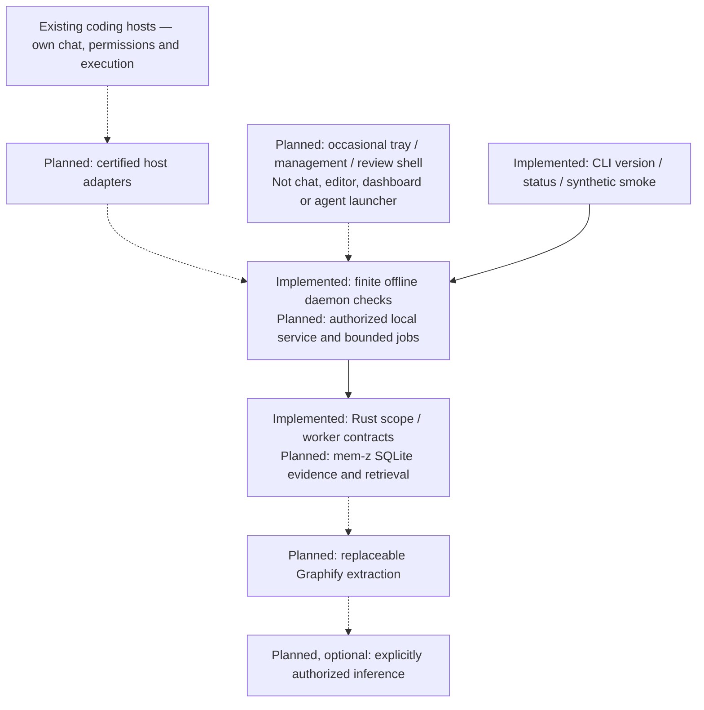

# Threadmark

[](https://github.com/suhaasbadada/threadmark/actions/workflows/ci.yml)
[](LICENSE)

## Project intelligence for every coding agent.

Threadmark is a planned local-first background companion that turns rough developer intent into grounded, project-aware execution briefs. It keeps project understanding portable across coding agents without replacing their tools, permissions, or workflows. It is not another chat application, editor, task dashboard, or agent launcher.

> Explain less. Carry context forward. Give every agent a better starting point.

**Status: early foundation development.** The Rust workspace provides offline version/status diagnostics and synthetic scope/worker contract checks. There is no installable companion, persistent index, background service, inference provider or released integration yet. All product workflows below remain planned and require runtime validation.

## Try the foundation from source

With Git, [Rustup](https://rustup.rs/) and Python 3.11+ installed:

```sh
git clone https://github.com/suhaasbadada/threadmark.git
cd threadmark
cargo build --workspace --locked
cargo run --locked -p threadmark-cli -- --version
cargo run --locked -p threadmark-cli -- status
cargo run --locked -p threadmark-cli -- smoke
python3 scripts/check.py
```

Rustup uses the pinned toolchain automatically. `status` reports
`service=not-connected`; `smoke` runs one synthetic check and exits without
reading a project, contacting a provider, or sending a task. These are developer
diagnostics, not a working product demo. See [development](docs/development.md)
for security checks, fixtures and platform limits.

## The problem

Switching coding agents often means repeating architecture, decisions, constraints, and previous corrections. A vague request can send an agent toward the wrong implementation even when the necessary knowledge already exists somewhere in the project.

Threadmark aims to supply the right evidence for the task, identify likely failure points, and reduce unsupported assumptions—not merely make prompts longer.

## The proposed experience

1. Add a project and approve which sources Threadmark may read.
2. Build project understanding: a source-backed map, evidence index, and editable decisions. Structural analysis runs locally; inference-backed stages require an explicit provider and budget.
3. Add or correct context in an occasional management window. Your decisions survive reindexing and remain distinguishable from observed implementation facts.
4. Continue working in your coding tool. Invoke explicit refinement through a supported host command or a small companion surface; inspect relevant context, constraints, unknowns, likely failure mechanisms, and verification guidance.
5. Edit, approve, and hand the brief to your coding tool through its certified workflow. Canceling refinement never submits a task; draft-only bridges leave Send to you.
6. Threadmark stays in the menu bar and maintains understanding in the background. Carry accepted corrections into other certified clients without adopting a new coding workspace.

## Working with your tools

- **OpenCode:** planned native command, review, approval, and opt-in context integration.
- **T3 Code:** planned draft prefill into a selected thread, followed by the user's own Send action; deeper integration is certified per provider.
- **Claude Code and Codex:** planned context and correction-continuity adapters.
- **Antigravity, Copilot, Cursor, and others:** staged support for the exact capabilities each environment exposes.

MCP access, automatic context injection, editable prompt refinement, and sending are different capabilities. Threadmark will not label them interchangeable. See [integration design](docs/integrations.md).

## Architecture direction

A Rust core, local daemon, and CLI; a thin menu-bar/management shell with temporary review surfaces; SQLite-backed evidence and retrieval; and small host-specific adapters. Graphify is the initial candidate for a replaceable structural/semantic extraction worker, not an unquestionable source of truth or a mandatory graph database.

The internal knowledge layer is provisionally named **mem-z**.



Solid arrows describe current crate dependencies; dashed arrows are planned
boundaries, not certified runtime connections. Hosts remain independent executors.

## Roadmap

The scope is divided into [Phases 0–9](docs/roadmap.md):

0. Engineering and SDLC foundation
1. Feasibility and integration contracts
2. Rust mem-z core
3. Background onboarding and editable context
4. Grounded context and prompt refinement
5. First complete OpenCode and T3 workflows — functional MVP
6. Cross-agent continuity — private alpha
7. Broader coding-environment coverage
8. Hardening and public beta
9. Stable release and sustainable operation

Phases are acceptance gates, not release dates. The foundation is under development;
all phase exits remain open until their evidence is reviewed. See the
[progress record](docs/progress/phase-0.md).

## Documentation

- [Product requirements and user experience](docs/product.md)
- [Detailed phase-wise product specification](docs/spec/README.md) — ten phase contracts with journeys, behavior, failure paths, and acceptance IDs
- [Architecture and knowledge lifecycle](docs/architecture.md)
- [Coding-environment integrations](docs/integrations.md)
- [Numbered phases and exit gates](docs/roadmap.md)
- [Development process and definition of done](CONTRIBUTING.md)
- [Security and privacy design](SECURITY.md)

## What Threadmark does not promise

No perfect outputs, complete project comprehension, zero hallucinations, or guaranteed speedups. Added context must earn its place through evaluation. Agents remain responsible for discovery and execution, and their host environments retain their permission boundaries.

## License

[MIT](LICENSE) · Copyright 2026 Suhaas Badada. See [contributing](CONTRIBUTING.md)
and [security reporting](SECURITY.md) before opening a PR or reporting a vulnerability.
